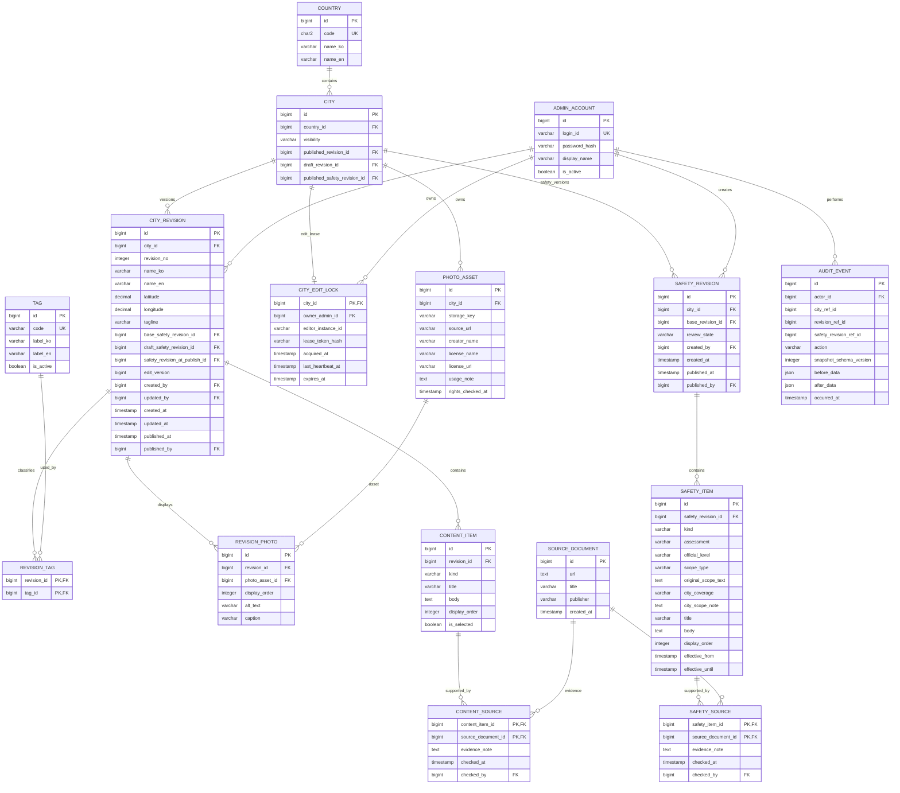

# TripeE MVP ERD v2

수정일: 2026-09-28. 논리 설계 문서이며 구현/DDL 검증 완료를 뜻하지 않는다. 현재 논리 모델임.

> PostgreSQL 채택 확정. 물리 자료형·제약조건·DB/서비스 책임의 최신 기준은 [제약조건 정의 v1](db-constraints-v1.md)과 [초기 DDL](../backend/db/schema.sql)을 따른다. DDL은 메모리 내 PostgreSQL 엔진으로 검증했으며 서비스 및 네이티브 서버 검증은 별도다.

## 1. 확정된 요구사항과 제안한 처리 규칙

### 사용자와 합의한 요구사항

- 일반 도시 콘텐츠는 수정본 전체를 게시한다. 도시마다 공용 수정 초안은 하나다.
- 다른 관리자가 해당 초안을 편집 중이면 일반 초안 편집에 진입할 수 없다.
- 관리자 페이지에서 사용자 활동이 1시간 없으면 자동 로그아웃한다.
- 안전정보는 일반 초안에서도 수정할 수 있고, 일반 초안 잠금과 무관한 별도 영역에서도 독립 게시할 수 있다.
- 공개했던 내용은 이력으로 확인하되 복원 기능은 제공하지 않는다.
- 비공개는 데이터를 유지한다. 삭제는 도시 업무 데이터를 DB에서 실제 제거하고 이력만 남긴다.
- 도시 3개, 사진 슬라이드, 도시용 태그, 대표 경험 최대 3개 표시 및 출처/확인일 정책은 유지한다.
- 편집 잠금은 1분마다 연결을 확인하고, 서버가 마지막 유효 연결 확인을 받은 뒤 5분이 지나면 만료한다.
- 이력은 텍스트와 사진 메타데이터를 보존하는 현재 범위로 충분하며, 삭제한 사진 원본의 재생은 요구하지 않는다.
- 안전정보 기반 버전 비교에 의한 덮어쓰기 방지 정책을 채택한다. 구현 및 동시성 검증은 후속 작업이다.
- 관리자 예외 동작은 아래 5절의 기본안으로 확정한다. 안전정보 충돌은 최신 정보와 수정 내용을 재검토하는 경로로만 해결하며, 수정 안전정보를 제외하고 즉시 게시하는 우회 선택지는 제공하지 않는다.

### 이번 설계에서 구체화한 제안

- 안전정보는 별도 버전과 별도 현재 공개 포인터를 사용한다. 안전정보 '최신'은 가장 늦게 도착한 요청이 아니라 최신 공개 버전을 확인하고 검증한 결과를 뜻한다.
- 일반 초안에서 안전정보를 변경하지 않았으면 도시 게시 시 현재 공개 안전정보를 그대로 유지한다.
- 일반 초안에서 안전정보를 변경했고 그 사이 다른 관리자가 안전정보를 게시했다면, 도시 전체 게시를 거부하고 안전정보 재검토를 요구한다. 일반 콘텐츠만 몰래 부분 게시하지 않는다.
- 일반 편집은 도시별 만료 가능한 잠금으로 제어한다. 연결 확인 간격 1분, 마지막 유효 확인 이후 만료 시간 5분으로 확정했다.
- 편집 잠금 만료와 인증 세션의 1시간 사용자 비활동 만료는 별개의 규칙이다.
- 과거 공개 버전은 도시가 존재하는 동안 보관한다. 물리 삭제 이후에는 독립된 감사 스냅샷으로 이력을 조회한다.
- 최초 게시, 재게시, 안전정보 게시에는 완전한 공개 상태 스냅샷을 남긴다. 삭제에는 전체 도시 이력 보관 스냅샷을 남긴다.

## 2. 전체 관계도

공개/초안 포인터 및 기반 버전 FK는 도표의 순환을 줄이기 위해 별도 관계선으로 표현하지 않았다. 감사 이벤트의 city_ref_id 등은 과거 식별값이며 도시·버전 테이블에 대한 FK가 아니다.

## 3. 버전과 안전정보의 관계

### 일반 콘텐츠

- CITY는 고정 식별자와 국가, HIDDEN / PREPARING / PUBLIC 노출 상태를 관리한다. deleted_at은 제거한다.
- CITY_REVISION은 이름·좌표·한 줄 소개 및 사진/태그/본문 연결의 게시 단위다.
- draft_revision_id가 가리키는 버전만 수정한다. 현재 공개본과 초안을 구분한다.
- 공개 버전과 하위 데이터는 불변이다. 삭제 작업 외에는 변경하지 않는다.

### 독립된 안전정보

- SAFETY_REVISION은 도시별 안전정보 묶음이다. review_state는 UNVERIFIED / PARTIAL / CHECKED이다.
- SAFETY_ITEM과 SAFETY_SOURCE는 SAFETY_REVISION에 연결된다. 내용·적용 범위·근거 확인 규칙은 v1과 같다.
- CITY.published_safety_revision_id가 현재 제공할 안전정보를 결정한다.
- CITY_REVISION.base_safety_revision_id는 일반 초안에서 안전정보를 검토한 기반 공개 버전이다.
- draft_safety_revision_id는 일반 초안에서 실제 수정하기 위해 만든 안전정보 복사본이다. 안전정보를 수정하기 전에는 NULL이다. 명시적인 편집 요청을 받을 때 생성한다.
- safety_revision_at_publish_id는 그 도시 버전을 게시했을 때 적용된 안전정보 버전이다. 과거 이력 조회용으로만 사용하며 현재 공개 안전정보 선택에 사용하지 않는다.
- SAFETY_REVISION.base_revision_id는 그 안전정보가 어떤 공개 버전을 바탕으로 만들어졌는지 기록한다.
- 일반 초안에는 수정 가능한 안전정보 복사본이 최대 하나다. 삭제된 초안의 고아 안전정보 복사본은 명시적으로 정리한다.
- 독립 안전정보 편집은 현재 공개 안전정보를 기준으로 한다. 다른 사람의 미완성 도시 초안에 있는 안전정보를 직접 수정하지 않는다.
- MVP에서 독립 안전 편집의 미게시 내용은 화면 상태로 유지하고, 게시 성공 시 새 SAFETY_REVISION을 원자적으로 생성한다. 별도 서버 임시저장 기능은 범위에 포함하지 않는다.
- 독립 게시 시에도 출처·적용 범위·확인일·권한 검증은 생략하지 않는다.
- 새 요청이 늦게 도착했다고 과거 출처가 최신 사실이 되는 것은 아니다. 출처의 시점과 현재 상황은 관리자가 검토해야 한다.

### 조회 및 이력

- 공개 페이지는 현재 일반 버전과 현재 안전 버전을 조합한다. 서로 독립적인 갱신이 의도된 구조다.
- 두 포인터는 한 번의 일관된 조회로 확보하고, 하위 조회도 해당 ID에 고정한다. 물리 삭제와의 경쟁은 읽기 트랜잭션 또는 재조회/삭제 응답 정책으로 처리한다.
- 도시 버전 이력은 safety_revision_at_publish_id를 사용한다. 그 뒤 독립 게시된 안전정보는 별도 안전 게시 이력에서 확인한다.
- 도시를 비공개로 두었으면 안전정보 독립 게시가 도시의 visibility를 PUBLIC으로 바꾸지 않는다.
- PREPARING은 최소 기본 정보와 준비 중 문구만 공개한다. 안전정보가 있다고 초안 전체를 공개하지 않는다.
- PREPARING 도시는 일반 공개 도시와 구분되는 핀으로 표시하고 검색 결과에도 '정보 준비 중'을 표기한다.

## 4. 게시 흐름과 충돌 처리

### 일반 초안 시작

1. 활성 관리자 세션을 검증하고 도시 편집 잠금을 원자적으로 획득한다.
2. 기존 초안이 있으면 이어서 편집한다. 없으면 공개본으로부터 새 초안을 만든다.
3. 새 초안 생성 시 현재 published_safety_revision_id를 base_safety_revision_id로 기록하고 draft_safety_revision_id는 NULL로 둔다.
4. 안전정보 편집 시작 시 기반 버전을 확인한다. 최신이 바뀌었다면 최신 내용을 다시 보여주고 사용자가 검토한 뒤 기반을 갱신한다.
5. 안전정보 편집본을 생성하고 일반 초안에 연결한다. 근거 확인일은 복사 시각으로 변경하지 않는다.

### 안전정보 독립 게시

1. 관리자 세션과 권한 확인. 일반 도시 편집 잠금은 요구하지 않는다.
2. 요청에 화면에서 확인했던 base_safety_revision_id를 포함한다. 최초 게시 전에는 NULL도 가능하다.
3. 짧은 DB 트랜잭션에서 CITY 행을 잠그고, 현재 공개 안전 버전과 기반 버전을 NULL까지 포함해 비교한다.
4. 다르면 게시를 거부한다. 입력 내용을 보존하고 최신 안전정보를 확인하도록 한다. 늦은 저장으로 덮어쓰지 않는다.
5. 같으면 출처·적용 범위를 검증하고 새 안전 버전 및 하위 행을 만든다.
6. 공개 안전 포인터 교체와 SAFETY_PUBLISH 감사 기록을 같은 트랜잭션으로 커밋한다.
7. 일반 초안과 그 잠금은 건드리지 않는다. 편집 중인 사용자에게 다음 조회/검사에서 안전정보 변경을 알린다.

### 도시 전체 게시

1. 로그인 상태, 편집 잠금 소유권·토큰·만료, 초안 edit_version 및 게시 요건 검사.
2. CITY 행을 짧게 잠가 안전 독립 게시/삭제와 순서를 정한다.
3. draft_safety_revision_id가 NULL이면 안전정보를 게시하지 않는다. 현재 안전 공개본을 그대로 사용한다.
4. 안전정보 수정본이 있다면 base_safety_revision_id와 현재 안전 공개 버전을 비교한다.
5. 일치하면 새 안전정보와 일반 콘텐츠를 같은 트랜잭션에서 게시한다.
6. 다르면 일반 콘텐츠까지 포함해 이번 게시를 거부한다. 초안은 유지한다.
7. 사용자는 최신 안전정보와 자신의 수정 내용을 함께 확인하고 재검토·수정한 뒤 재게시한다. 안전 수정본을 제외하고 즉시 게시하는 선택지는 제공하지 않는다. 재검토 완료 시 확인한 공개 버전을 새 기반으로 기록하며, 다시 게시할 때도 현재 공개 버전과 비교한다. 재검토 도중 다른 게시가 발생하면 다시 충돌 처리한다. 미확인 상태로 기반 ID만 바꾸는 API는 제공하지 않는다.
8. 일반 공개 포인터·게시 시점 안전 포인터·감사 스냅샷 갱신, 초안 포인터와 잠금 해제까지 원자적으로 처리한다.

예: A가 안전 v3을 바탕으로 편집 중 B가 v4를 독립 게시한 경우, A가 안전정보를 수정하지 않았다면 v4를 유지하며 도시를 게시한다. A가 안전정보까지 수정했다면 자동 게시하지 않고 재검토한다.

## 5. 편집 잠금과 1시간 자동 로그아웃

### 도시별 편집 잠금

- CITY_EDIT_LOCK.city_id가 PK이므로 도시당 잠금 하나만 존재한다. 서로 다른 도시는 동시에 편집할 수 있다.
- 잠금은 장시간 DB 트랜잭션이 아니라 만료 시각을 가진 데이터 행이다. DB 행 잠금은 획득/저장/게시 순간에만 짧게 사용한다.
- 소유 관리자뿐 아니라 편집 창의 editor_instance_id와 재획득할 때 새로 발급하는 토큰으로 구분한다. 같은 관리자의 다른 탭이 임의로 덮어쓸 수 없다.
- 모든 일반 수정/저장/게시 API에서 잠금을 검사한다. UI만 비활성화하는 것은 잠금 구현이 아니다.
- 다른 관리자는 일반 초안 편집 진입이 차단된다. 공개본·이력 조회 및 안전정보 독립 편집은 허용한다.
- 연결 확인은 1분 간격으로 요청한다. 유효한 세션·소유권·토큰을 확인한 뒤 서버 시각으로 last_heartbeat_at을 갱신하고 expires_at을 5분 뒤로 설정한다. 최초 획득 시에도 만료는 5분 뒤다.
- 서버 현재 시각이 expires_at 이상이면 만료로 판단한다. 별도 정리 작업이 행을 아직 지우지 않았어도 편집권은 없다. 이미 만료된 토큰의 연결 확인으로 잠금을 되살리지 않고 다시 획득하도록 한다.
- 정상 편집 종료/로그아웃 때 해제를 시도한다. 브라우저 종료 신호가 오지 않아도 서버 만료로 회수한다.
- 만료 후 다른 관리자가 획득하면 이전 토큰의 늦은 저장 요청을 거부한다. 네트워크 복구만으로 이전 편집권이 되살아나지 않는다.
- 저장된 초안은 잠금 만료로 삭제하지 않는다. 미저장 입력도 열려 있는 화면에서 유지하되 저장/게시를 막는다. 재인증 및 잠금 재획득 후 최신 초안을 확인하고 재입력·저장한다. 이전 입력은 복사할 수 있게 하며 자동 덮어쓰기·자동 병합하지 않는다. 새로고침이나 브라우저 종료 이후 복구는 MVP에서 보장하지 않는다.
- 삭제/비공개도 기존 일반 편집 잠금 정책을 따른다. 다른 사람이 편집 중인데 관리자가 임의로 삭제하도록 허용하지 않는다.

### 인증 세션

- 1시간은 해당 관리자 세션 전체의 '사용자 비활동' 시간이다. 페이지 이동, 입력, 명시적 버튼 조작 등을 기준으로 한다.
- 자동 폴링·잠금 생존 확인·자동저장은 사용자 활동으로 세지 않는다. 그렇지 않으면 사용자가 없어도 로그아웃이 영원히 연장된다.
- 프론트엔드는 사용자 활동을 합쳐 주기적으로 서버에 통지하고, 서버가 받은 시각을 기준으로 마지막 활동 시각을 관리한다. 클라이언트가 임의의 미래 시각을 지정하지 못하게 한다.
- 세션 만료 여부는 요청마다 서버에서 검사한다. 화면 타이머만으로 로그아웃을 구현하지 않는다.
- 이 정책은 브라우저의 활동 신호를 이용한 운영 정책이며 사람의 실제 존재를 강하게 증명하는 방식은 아니다.
- 만료 후 일반 저장과 안전정보 독립 게시 모두 거부한다. 자동 로그아웃은 안전정보 예외 대상이 아니다.
- 세션이 무효하면 잠금 갱신도 거부하고 잠금을 해제 또는 만료 처리한다.
- Spring Security 세션 구현 방식은 후속 단계에서 결정한다. 프레임워크 세션 저장 구조는 이번 도메인 ERD에 임의의 테이블로 추가하지 않는다.

### 확정한 관리자 동작

- '저장하고 편집 종료': 저장 성공 후에만 잠금을 해제한다. 저장 실패 시 종료 성공으로 표시하지 않는다. 다른 관리자의 잠금을 강제로 빼앗는 기능은 제공하지 않는다.
- '수정 초안 폐기': 명시적 확인을 받은 뒤 초안 포인터와 초안 전용 하위 데이터를 제거한다. 공개본과 현재 공개 안전정보는 유지한다. 공개 이력이 있는 도시에는 DISCARD_DRAFT 로그를 남긴다. 폐기할 내용은 로그에 기록하고, 다른 버전이 참조하는 사진 자산/공용 출처는 제거하지 않는다.
- 게시 전에는 전체 미리보기와 마지막 수정자·시각을 표시한다. 마지막 수정자는 일반/연결된 안전 초안의 유효한 저장 작업을 기준으로 한다. CITY_REVISION.updated_by는 ADMIN_ACCOUNT를 참조하며 하위 편집에도 updated_at/updated_by를 함께 갱신한다.
- '사진 제외': 현재 초안의 REVISION_PHOTO 연결만 제거한다. 과거 공개본이 참조하는 파일은 유지한다. 개별 사진 파일 영구 삭제 기능은 MVP에서 제공하지 않는다. 도시 전체 삭제의 파일 정리 정책과 구분한다.
- 안전 충돌 시 일반 콘텐츠와 안전 수정 입력을 유지한다. 최신 안전정보와 수정본을 확인·수정하고 명시적으로 재검토를 완료한 뒤 게시한다. 자동 병합이나 안전 수정 제외를 통한 즉시 게시 기능은 제공하지 않는다.

## 6. 이력 보존과 물리 삭제

### 감사 로그 구조 변경

- AUDIT_EVENT.city_ref_id / revision_ref_id / safety_revision_ref_id는 재사용하지 않는 과거 ID 값이다. 업무 행 삭제를 방해하는 FK로 만들지 않는다.
- actor_id는 비활성화만 허용하는 ADMIN_ACCOUNT를 참조한다.
- 최초 게시부터 기록한다. 최초 게시 이전 도시를 삭제하더라도 DELETE 이력은 남긴다.
- 최초 게시/재게시에는 당시 공개 내용을 읽을 수 있는 완전한 after_data 스냅샷을 저장한다.
- 안전 게시 이벤트에는 전후 안전 버전과 해당 시점 일반 공개 버전 ID를 함께 기록한다.
- 초안 수정은 필드 변경분을 남길 수 있다. 삭제 기록에는 모든 버전과 연결 정보를 펼친 아카이브를 포함하여 업무 행이 없어도 이력을 해석할 수 있게 한다.
- 스냅샷에는 당시 도시/국가명, 태그 문구, 경험과 정보 본문, 안전정보, 출처/확인일, 사진 설명·출처·이용 조건을 포함한다. 삭제될 FK 값만 보관하지 않는다.
- 사진 바이너리는 감사 JSON에 넣지 않는다. 도시 삭제 후 과거 사진 파일 자체를 재생하는 것은 보장하지 않으며 이력에는 파일 식별자·설명·출처를 남긴다.
- snapshot_schema_version으로 이력 JSON 형식을 식별한다.
- 비밀번호, 세션, 잠금 토큰, AI API 키는 로그에 기록하지 않는다.

### 삭제 처리

1. 관리자 권한·잠금 소유권 및 도시를 확인한다. 짧은 트랜잭션에서 도시 행을 잠가 게시와 삭제 순서를 정한다.
2. 도시 전체 이력 스냅샷과 삭제 작업자를 감사 로그에 기록한다. 로그 저장 실패 시 삭제도 하지 않는다.
3. 도시의 visibility를 HIDDEN으로 바꾸고 공개/초안/안전 포인터를 같은 UPDATE에서 해제한다. 공개 버전 자체의 안전 스냅샷 참조는 NULL로 수정하지 않는다.
4. 일반 버전 및 전용 하위 연결/본문을 제거하고, 안전 버전과 항목/연결을 제거한 뒤 사진 자산과 CITY를 삭제한다. 버전 간 지연 FK는 트랜잭션 끝에 검사한다. 편집 잠금은 도시 삭제에 따라 제거된다.
5. COUNTRY, TAG, ADMIN_ACCOUNT 및 다른 도시가 참조하는 SOURCE_DOCUMENT는 삭제하지 않는다. 참조가 없는 출처 문서는 별도 정리 대상으로 둔다.
6. 감사 이벤트는 남기고 커밋한다. 삭제 후 읽기/저장/게시 API는 도시 없음으로 응답한다.
7. 실제 사진 파일은 DB 커밋 이후 제거한다. 파일 삭제 실패 시 감사 삭제 이벤트에 기록된 storage_key를 이용해 재시도할 수 있도록 운영 정리 절차를 둔다. DB 롤백과 파일 삭제를 같은 원자 작업으로 가정하지 않는다.

비공개는 위 삭제 절차를 수행하지 않는다. visibility만 바꾸고 데이터를 유지하며 비공개 이벤트를 기록한다. 다시 공개할 때 게시 요건을 재검증한다.

## 7. 유지되는 테이블 규칙과 3NF

- COUNTRY.code, TAG.code, ADMIN_ACCOUNT.login_id는 유일하다. 도시 이름은 고유키가 아니다.
- TAG는 도시 분류이며 REVISION_TAG로 버전에 연결한다. 동일 버전·태그 중복 불가.
- PHOTO_ASSET은 한 도시 소유다. REVISION_PHOTO는 버전별 순서/대체 텍스트/설명이다. 다른 도시 자산 연결 불가.
- CONTENT_ITEM.kind는 EXPERIENCE / CONSIDERATION / VISIT_PERIOD / ARRIVAL / LOCAL_TRANSPORT이다.
- CONTENT_ITEM.is_selected=true인 EXPERIENCE를 순서대로 최대 3개 표시한다. 다른 유형은 선정된 항목을 순서대로 표시한다.
- SOURCE_DOCUMENT는 공용 원본 문서 메타데이터다. CONTENT_SOURCE/SAFETY_SOURCE에 항목별 근거·확인일·확인자를 둔다.
- 실제 사진/자료 이용권 확인 및 게시 필수 조건은 v1과 동일하다.
- 게시된 본문과 참조 메타데이터는 삭제 작업 외에는 변경하지 않는다. 새로운 자료 상태는 새 레코드로 만든다.
- 감사 로그 JSON은 역사 기록이며 정규화된 업무 조회 테이블을 대체하지 않는다.
- 편집 잠금은 임시 운영 상태이고 콘텐츠 버전의 업무 속성과 분리한다.
- 안전 검토 상태는 안전 버전에만 속한다. 도시 일반 버전에 중복 저장하지 않는다.

## 8. 필수 무결성 규칙

- CITY_REVISION UNIQUE(city_id, revision_no), UNIQUE(city_id, id); SAFETY_REVISION UNIQUE(city_id, id).
- 도시의 공개/초안 일반 포인터와 안전 포인터는 해당 도시의 버전만 가리키도록 복합 FK를 설정한다.
- CITY_REVISION의 안전 기반/초안/게시 당시 포인터와 SAFETY_REVISION 기반 포인터도 같은 도시 범위를 보장한다. 구체적인 복합 FK DDL은 다음 단계에서 작성한다.
- 일반 초안과 일반 공개 포인터는 서로 다르다. PUBLIC은 유효한 일반 공개본을 요구한다.
- 안전 미확인도 최초 게시 때 UNVERIFIED 안전 버전으로 명시적으로 게시하여 공개 안전 포인터를 확보한다.
- 기존 v1의 순서 UNIQUE, 양수 순서, 위도/경도 범위, 출처 연결 복합 PK, 상태 CHECK를 유지한다.
- SAFETY_ITEM 순서 UNIQUE는 (safety_revision_id, display_order)로 변경한다.
- CITY_EDIT_LOCK은 도시별 한 행, token 재발급, 만료 및 세션 유효성을 서버에서 검사한다.
- CITY_REVISION.edit_version으로 같은 편집 창의 늦게 도착한 요청도 감지한다. 잠금을 얻었다고 요청 순서 문제가 사라지지는 않는다.
- 모든 일반/안전 게시 및 삭제는 CITY 행을 일관된 순서로 짧게 잠근다. 편집 중 전체 시간 동안 DB 트랜잭션을 열어두지 않는다.
- 안전 게시 기반 버전 비교와 포인터 교체는 동일 트랜잭션 안에서 실행한다. 인증 검사는 항상 필요하다.
- 감사 이력은 업무 테이블의 CASCADE DELETE 대상이 아니다. 도시 소유 데이터의 삭제 순서/연쇄 범위는 DDL에서 명시한다.

## 9. 검증 시나리오

1. A가 교토 편집 잠금을 보유하면 B는 교토 일반 초안 편집 불가, 나폴리 편집 가능.
2. B가 별도 안전정보 영역에서 교토 안전정보를 게시해도 A의 일반 편집 잠금은 유지된다.
3. A가 안전정보를 수정하지 않고 도시 게시하면 B의 최신 안전정보가 유지된다.
4. A가 오래된 안전정보를 수정했다면 도시 전체 게시가 거부되고 초안은 보존된다.
5. B와 A가 같은 안전 기반으로 독립 게시하면 첫 게시 이후 두 번째 게시가 충돌로 거부된다.
6. 주기적 heartbeat/자동저장만 발생해도 1시간 동안 사용자 활동이 없으면 세션이 만료된다.
7. 사용자 입력은 있지만 HTTP 저장 요청이 없는 동안에도 활동 통지가 세션에 반영된다.
8. 창 강제 종료 후 임대가 만료되면 B가 편집 가능하다. A의 지연 저장은 이전 토큰으로 거부된다.
9. 잠금이 있어도 세션 만료 후 일반 저장과 안전정보 게시 모두 거부된다.
10. 비공개는 데이터 유지, 삭제는 도시·일반 버전·안전 버전·연결 행을 제거한다.
11. 삭제 후 감사 기록으로 과거 공개 내용을 읽을 수 있고 도시 FK 조인이 필요하지 않다.
12. 다른 도시가 공유하는 태그/출처가 함께 삭제되지 않는다.
13. 로그 저장 실패 시 삭제가 롤백되고, 파일은 DB 커밋 전 삭제되지 않는다.
14. 안전 게시와 도시 삭제가 겹쳐도 고아 안전 버전이 생성되지 않는다.
15. 독립 안전 게시가 비공개 도시를 자동 공개하지 않는다.
16. 삭제 후에도 남아 있는 관리자 창에서 저장을 요청하면 재생성하지 않고 도시 없음으로 처리한다.
17. 잠금/세션 만료 후 화면 입력은 남지만 저장이 차단되고, 재획득 시 이전 입력이 최신 초안을 자동으로 덮어쓰지 않는다.
18. '저장하고 편집 종료'에서 저장 실패 시 잠금을 정상 해제한 것처럼 처리하지 않는다.
19. 초안 폐기는 기존 공개 콘텐츠·최신 안전정보·이전에 참조한 사진을 제거하지 않고 이력을 남긴다.
20. 안전정보 재검토 도중 추가 안전 게시가 발생하면 재게시 요청도 충돌로 거부된다.
21. 게시 미리보기의 마지막 수정자·시각에 하위 사진/본문/안전 초안 변경도 반영된다.

## 10. 미구현 및 후속 결정

- PostgreSQL 채택과 초기 DDL 작성은 완료했다. 제약 검증 결과 및 미검증 범위는 db-constraints-v1.md를 따른다. API 구현과 네이티브 서버 동시성 검증은 후속 작업이다.
- 자동 로그아웃 활동 통지 주기와 만료 전 알림의 세부 표현은 구현 단계에서 확정한다. 잠금 연결 확인 1분/만료 5분, 사용자 비활동 로그아웃 1시간 및 화면 내 미저장 입력 유지 정책은 확정 사항이다.
- 안전 충돌 화면은 최신 내용을 보고 재검토하는 최소 동작으로 시작한다. 자동 병합은 하지 않는다.
- 삭제 이력에 사진 원본 바이너리까지 보관하는 요구는 현재 없다. 텍스트·메타데이터 중심 이력이다.
- 관리자가 삭제한 도시의 DB 백업까지 즉시 지우는 정책은 별도 운영 주제이며 이 MVP 삭제 범위에 포함하지 않는다.
