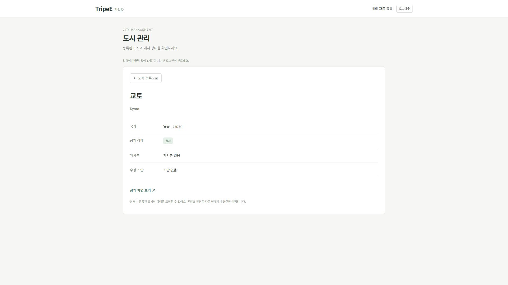
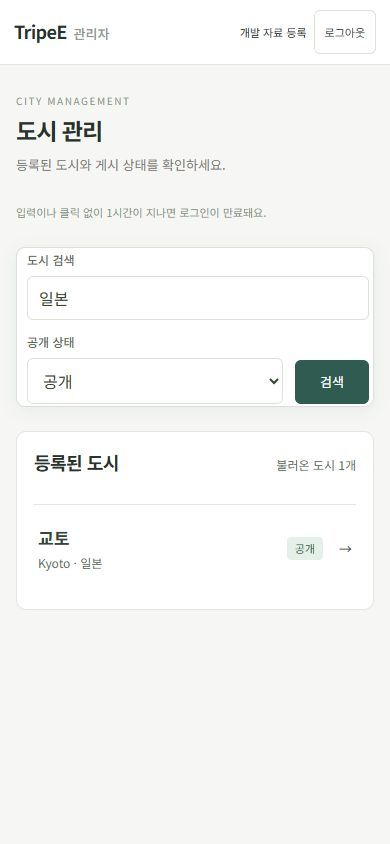
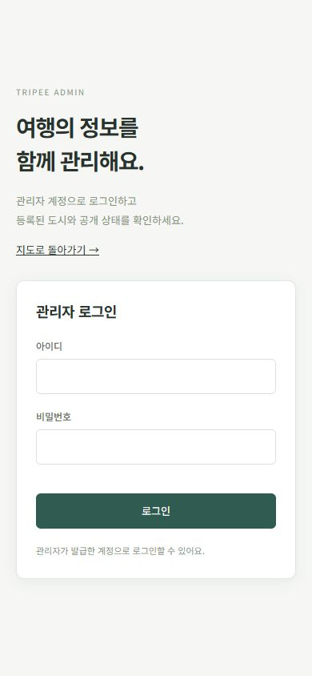

# 관리자 로그인·도시 조회 검수

2026-11-23, `codex/feature-admin-session-city-api` 작업 기준임.
교토 등록·공개 화면 PR #6을 기반으로 진행했음. 관리자 변경은 PR #6에 포함하지 않음.

## 실행과 확인

1. 개발 DB와 PostgreSQL 프로필 백엔드를 실행하고 `pnpm dev`로 프론트를 실행함.
2. `/admin`에 접속하고 개발 DB에 등록된 계정으로 로그인함. 로컬 교토 등록 도구가 생성한 계정은 `.local-archive/kyoto-import-admin.json`에 있음. 계정 파일은 Git·PR에 첨부하지 않음.
3. 잘못된 비밀번호 안내, 정상 로그인, 새로고침 후 로그인 유지를 확인함.
4. 교토·Kyoto·일본 검색, 공개·비공개·준비 중 필터와 빈 결과를 확인함.
5. 교토의 게시본·초안 상태를 조회하고 공개 화면 링크를 확인함. 목록으로 돌아왔을 때 기존 검색과 목록이 유지되어야 함.
6. 로그아웃 후 새로고침하거나 다른 관리자 탭을 새로고침하면 로그인 화면이 표시되어야 함.
7. `/admin?demo=1`에서 기존 A/B 편집 시연을 사용할 수 있음을 확인함.

## 검증 범위

- 관리자 테스트 32개: 기존 시연 22개, API·활동 보고 10개임. CSRF 교체, 실패 요청 자동 재전송 방지, 401 처리, 요청 취소, 사용자 동작 없는 자동 연장 방지를 확인함.
- Windows 실제 개발 서버에서 로그인 실패·성공, 새로고침 복원, 일본 검색, 교토 상태 조회, 필터, 로그아웃과 다른 탭 새로고침을 확인했음.
- PC 1920×1080, 모바일 390×844 브라우저 크기에서 배치를 확인했음. 모바일 로그인에 공통 폼 스타일이 섞이던 문제를 수정했음.
- 한 시간 대기 후 실제 만료, 20개를 넘는 도시의 브라우저 추가 조회, 실제 휴대폰 키보드와 Mac 실행은 아직 확인하지 않았음. 만료 시각 계산·활동 보고·페이지 커서 전달은 자동 테스트로 검사함.
- 도시 상세는 관리자용 등록 상태 조회임. 콘텐츠 편집·사진 업로드·게시 연동은 후속 작업임.

## B 검수 항목

- [ ] Mac의 개발 DB·백엔드와 같은 흐름이 동작하는지 확인함.
- [ ] 실제 `/admin`과 시연 `/admin?demo=1`의 경계 및 조회 범위를 확인함.
- [ ] CSRF 교체, 세션 만료 안내, 활동 보고 주기가 백엔드 정책과 맞는지 확인함.
- [ ] 검색·필터·목록 복귀와 모바일 입력 배치를 확인함.

관리자 PR은 교토 PR 병합 후 develop 기준으로 변경 범위를 다시 정리해 올릴 예정임. 교토 PR을 Squash merge하면 관리자 커밋만 새 develop 위로 옮겨 중복 변경을 제외함. 작업 PR의 대상은 기존 규칙대로 develop을 사용함.

